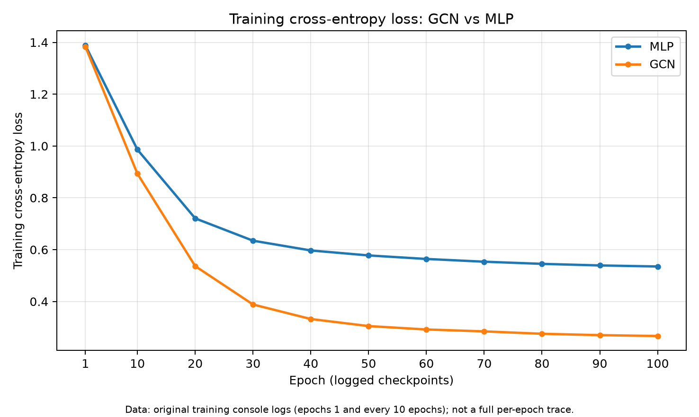
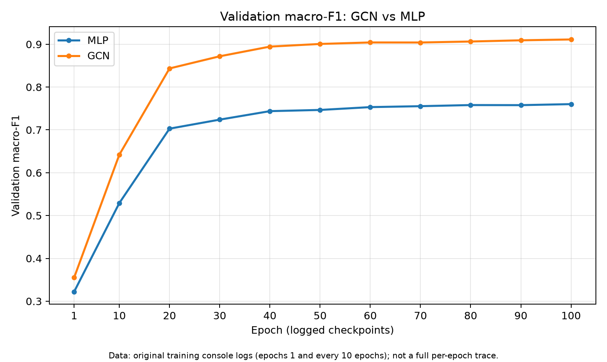
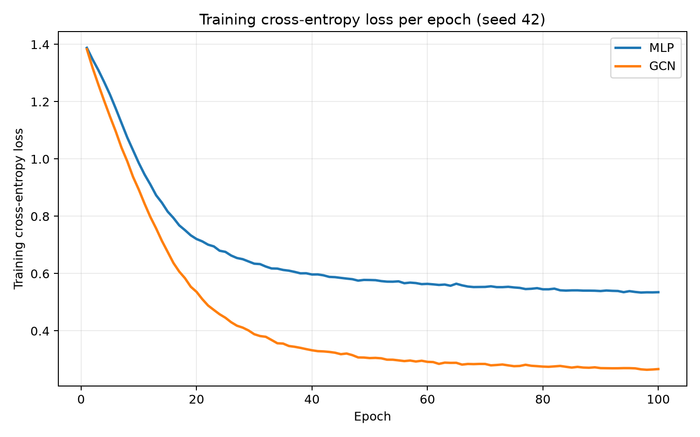
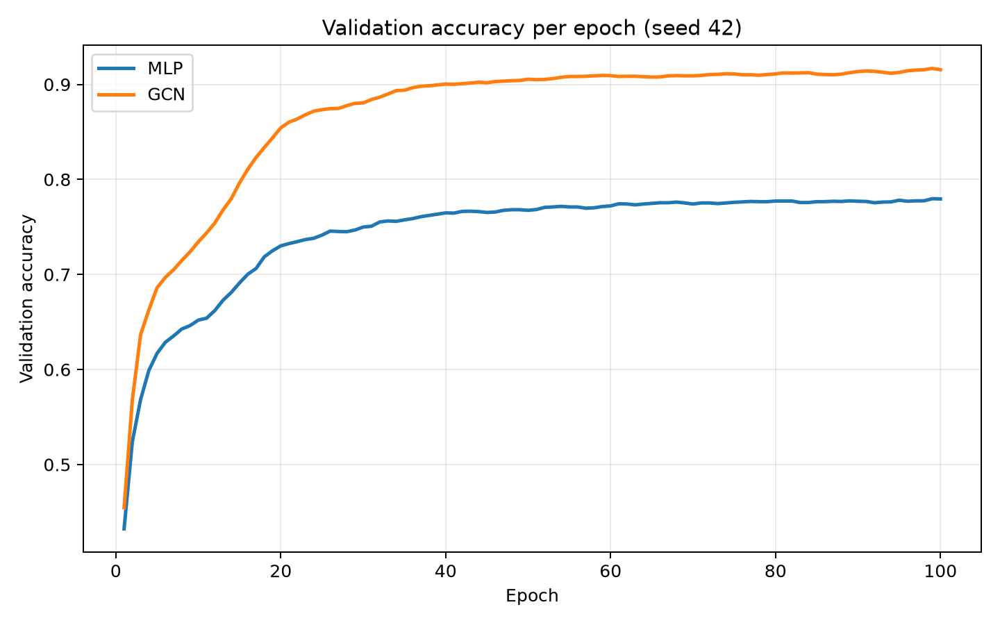
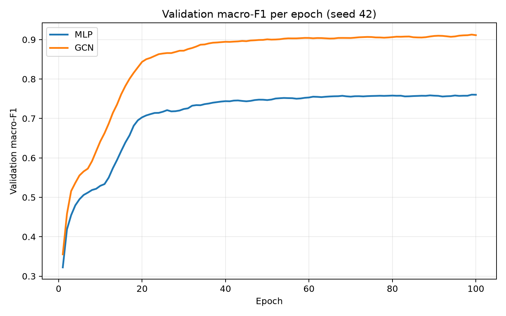
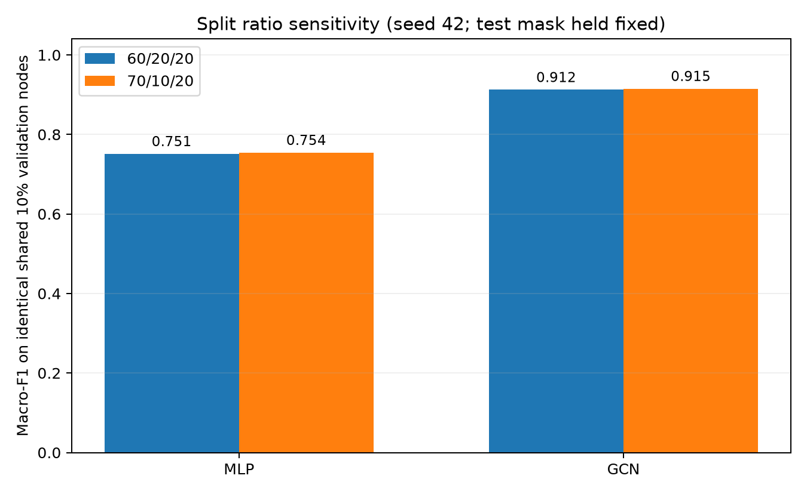
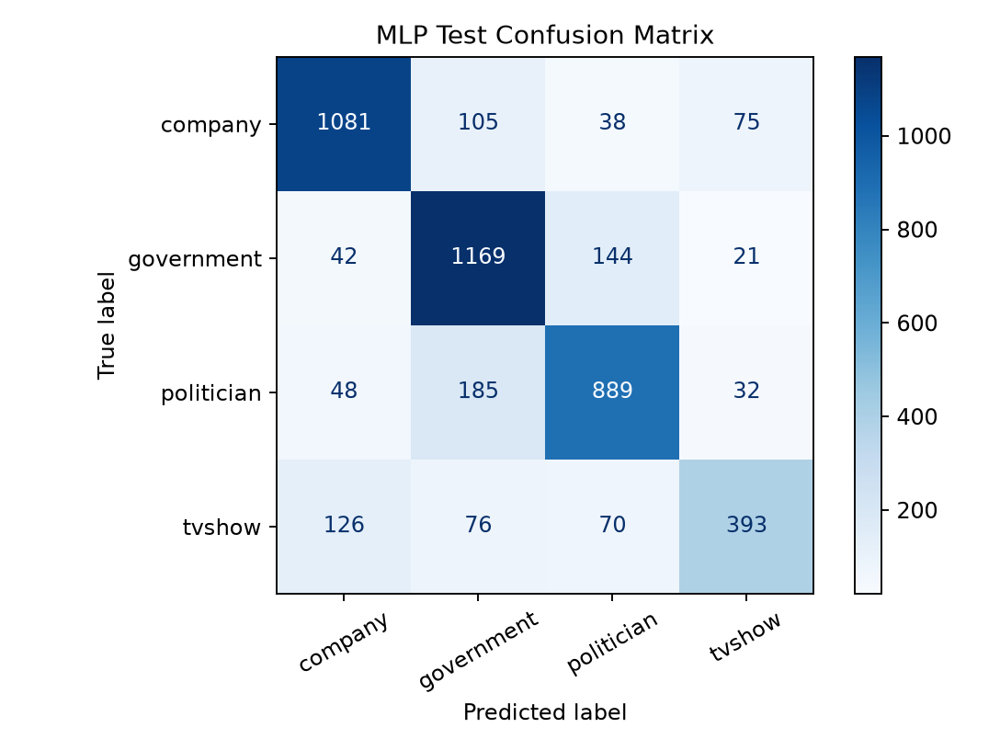
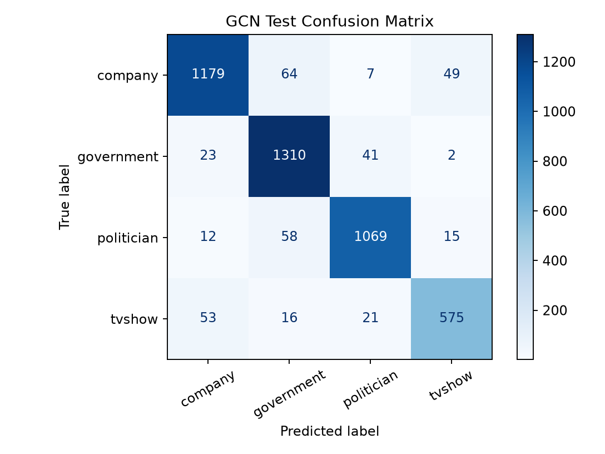
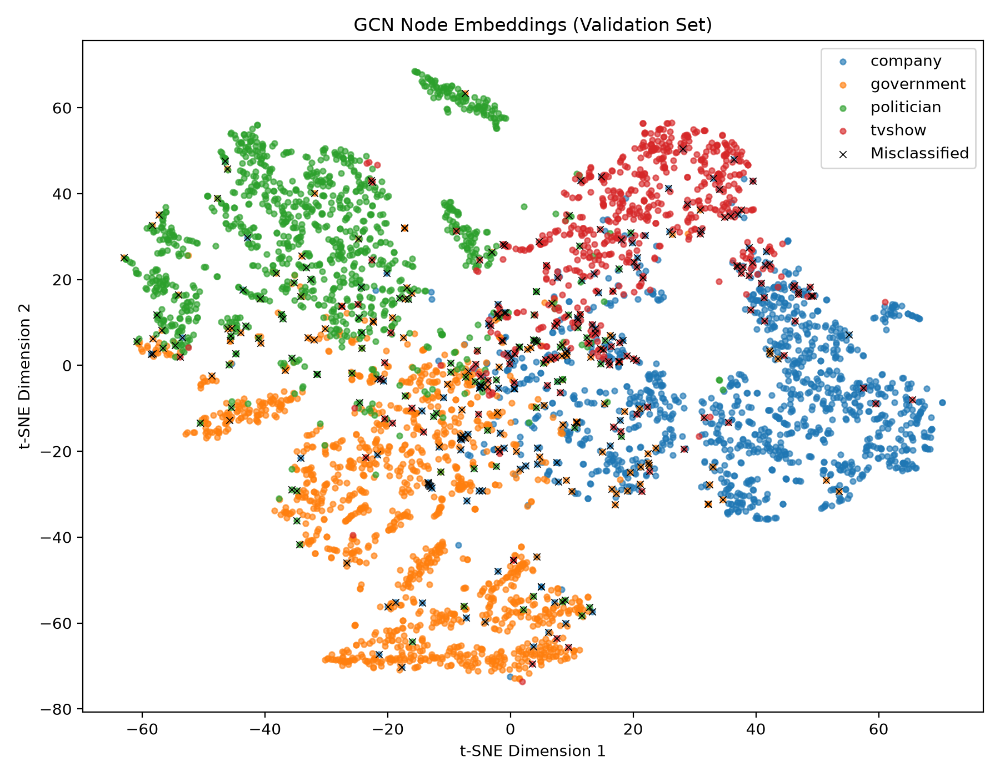

# Facebook Page Classification Using a Two-Layer Graph Convolutional Network

**COMP3710 Pattern Recognition — Normal Difficulty (Multi-layer GNN)**  
**Author:** Jason Ji · **Student ID:** 49832853  
**Project folder:** `recognition/GCN_49832853/`  
**Evaluation date:** 28 October 2026 · **Evaluation split:** one fixed, stratified 60/20/20 split (seed 42)

## 1. Problem and engineering objective

This project investigates semi-supervised classification of Facebook pages into four classes: **company**, **government**, **politician**, and **tvshow**. An analyst may use an automated classifier to categorize pages while sending uncertain cases for manual review. In this graph, nodes represent pages and links describe page-to-page relationships. The central engineering question is whether graph connectivity improves **classification performance and confidence reliability** compared with a feature-only multilayer perceptron (MLP), and whether the improvement justifies its computation cost.

The proposed solution is a **two-layer Graph Convolutional Network (GCN)** implemented with PyTorch Geometric. Unlike the baseline MLP, it aggregates neighbouring-node features during inference. Both models use the same 128-dimensional input features, a 64-unit hidden layer, identical node splits, and **8,516 trainable parameters**. This isolates the primary architectural difference—whether graph edges are used—while keeping model size comparable.

### Architecture

```text
Full graph: 22,470 nodes × 128 features; 342,004 directed edge entries
                   |                          |
                   |                          +--- MLP baseline
                   |                               Linear(128,64) -> ReLU
                   |                               -> Dropout(0.5)
                   |                               -> Linear(64,4)
                   |
                   +--- GCN model
                        GCNConv(128,64) -> ReLU
                        -> Dropout(0.5)
                        -> GCNConv(64,4)
                                   |
                         Four-class logits
                                   |
                       Softmax -> predicted class
```

Both models use cross-entropy loss and Adam optimization. A GCN layer applies a trainable feature transformation and degree-normalized neighbour aggregation. With adjacency matrix $A$, self-loop-augmented adjacency $\tilde A=A+I$ and corresponding degree matrix $\tilde D$, a simplified layer is $H^{(l+1)}=\sigma(\tilde D^{-1/2}\tilde A\tilde D^{-1/2}H^{(l)}W^{(l)})$ [1]. The MLP computes node representations independently of graph edges. Softmax scores are reported as **confidence heuristics**, not guaranteed probabilities of correctness.

## 2. Dataset, preprocessing, and leakage control

| Property | Value |
|---|---|
| Dataset | Facebook Large Page-Page Network, modified NPZ format |
| Nodes | 22,470 |
| Edge entries | 342,004 directed entries (both orientations of approximately 171,002 undirected links) |
| Features | 128 per node |
| Classes | company (0), government (1), politician (2), tvshow (3) |
| Nodes per class | 6,495 / 6,880 / 5,768 / 3,327, respectively |
| Split | Stratified 60% train / 20% validation / 20% test; seed 42 |
| Train / validation / test | 13,482 / 4,494 / 4,494 nodes |

The supplied `facebook.npz` contains `X` (22,470 × 128), `edges_x` and `edges_y` (342,004 entries each), `y` (22,470 class IDs), and `page_name` metadata (stored as an object array, not read by the training loader). `dataset.py` reads the numeric arrays and constructs a PyTorch Geometric `Data(x, edge_index, y)` object. The modified dataset supplies **precomputed 128-dimensional node features**, produced upstream by `TruncatedSVD(n_components=128, random_state=42)` from a binary 4,714-token description-feature matrix, as shown in the supplied conversion notebook `data/GCN_Facebook_003_DATASET.ipynb`. The training pipeline uses these features as-is and does not fit SVD again or train a text encoder. This preprocessing is unsupervised but performed globally, consistent with the stated **transductive** setting; this is not an inductive pipeline for unseen graphs. Edges are represented in both directions.

**Label-mapping verification:** comparing all 22,470 NPZ labels with the original `musae_facebook_target.csv` records confirmed `0=company`, `1=government`, `2=politician`, and `3=tvshow`. The accompanying dataset README contains a conflicting mapping, so class names in all reports and figures are based on the verified raw target records. This avoids silently mislabelling evaluation metrics.

**Learning setting: transductive.** During graph convolution, node features and graph connectivity are available for the entire graph, including validation and test nodes. However, **only training-node labels** contribute to the training loss. Validation labels are reserved for selecting the model/operating rule; test labels are held out until the final evaluation. The node masks are reproducible, disjoint, and collectively cover all nodes. This evaluates held-out **node labels on the same graph**, not transfer to a completely unseen graph.

An initial audit found that approximately **88.35% of non-self links connecting training nodes** connect nodes of the same category. This relatively high homophily provides a reason to test graph message passing, but does not guarantee correct classification for every node.

### Data availability

The modified Facebook Page-Page dataset format and preprocessing pipeline used in this project are documented in [Gayanku's Facebook Page-Page dataset repository](https://github.com/gayanku/facebook_page-page_dataset) [5]. The original Facebook Large Page-Page Network CSV/JSON files are available from the UCI Machine Learning Repository [3].

To reproduce the dataset:

1. Download the original Facebook Large Page-Page Network dataset from UCI [3] and extract its CSV/JSON files into `recognition/GCN_49832853/data/facebook_large/`.
2. Open the [conversion notebook](data/GCN_Facebook_003_DATASET.ipynb), included in this repository. Run its conversion cells from the `data/` directory, skipping the Google Colab-specific setup cell. The notebook applies TruncatedSVD to generate 128-dimensional node features and converts the graph into the modified NPZ format.
3. Save the generated `facebook.npz` to `recognition/GCN_49832853/data/facebook.npz`. This is the exact path expected by `dataset.py`.

The generated NPZ file and original raw dataset files are excluded from Git to avoid committing large data artifacts. However, the conversion notebook is included in the repository to document the preprocessing procedure and support reproducibility.

## 3. One-page feasibility review (initial check-off)

*This section preserves the original preliminary feasibility objectives and evidence; it does not substitute the final test results for the earlier smoke test.*

**1. User Need & Acceptance Criteria.** An analyst needs to classify verified Facebook pages (company, government, politician, TV show) and flag uncertain results for review. Research question: *Does graph context improve classification and confidence reliability over a feature-only MLP?*

1. Use reproducible stratified 60/20/20 node masks; train with training labels only.
2. Compare GCN against MLP on the same split; report accuracy, macro-F1 (target ≥ 0.70), per-class recall and AUROC.
3. Visualise embeddings (t-SNE/UMAP), analyse 3–5 errors and test a validation-examined confidence threshold.
4. Measure peak memory and full-graph CPU inference time (target < 1 s); keep parameters < 20,000.

**2. Model Choice & Course Concepts.** The course-specified Facebook Page-Page graph contains 22,470 nodes, 342,004 directed edge entries, 128 features and four classes. A transductive two-layer GCN uses `GCNConv(128,64) → ReLU → Dropout(0.5) → GCNConv(64,4)`. Its graph-based message passing is compared with an MLP without edges. References: Kipf & Welling (2017) and Rozemberczki et al. (2021).

**3. Preliminary Feasibility Evidence.** The modified NPZ loaded successfully into PyTorch Geometric. About 88.35% of non-self edges between training nodes link the same class (seed 42; recalculated from the supplied graph). In a five-epoch CPU smoke test (Adam, `lr=0.01`), training loss dropped from 1.3833 to 1.1487 and validation accuracy increased from 45.46% to 68.60%. The model has 8,516 parameters; training plus evaluation took approximately 0.80 s. This was evidence of a working prototype, not a comparison with the MLP.

**4. Risks, Budget & Fallback.** Risks included class imbalance, over-smoothing, label leakage and overconfident errors. The budget was CPU-first, up to 100 epochs with early stopping. The next planned experiments were an MLP baseline and confidence/error analysis. The fallback was to tune the shallow GCN or report no improvement if the baseline performed equally well.

## 4. Implementation and training procedure

The implementation separates graph loading (`dataset.py`), model architectures (`modules.py`), supervised training (`train.py`), single-node inference (`predict.py`), and supplementary analyses (`evaluate.py`, `analyze.py`, `visualise.py`, `benchmark.py`, `final_test.py`, `split_ablation.py`).

In the original experiment, both models were trained using the same 60/20/20 node split (seed 42), hidden width 64, dropout 0.5, Adam learning rate 0.01, weight decay 0.0005, cross-entropy on training labels only, up to 100 epochs, and validation macro-F1 for checkpoint selection. The best validation epoch was **99** for both models. Early stopping was configured with patience 15 but was not triggered before the 100-epoch ceiling. Thus the training budget yielded strong performance but does **not establish full convergence**. The final evaluation loaded the previously saved checkpoints and **did not retrain or tune them on the test set**.

### Original experiment: sampled training curves

The original training script printed loss and validation metrics at **epoch 1 and every tenth epoch** through epoch 100, retaining **11 actual recorded observations per model**. It did not preserve a complete per-epoch history. These numeric observations were transcribed from the console logs. The two plots below show only those 11 observations, connected for readability; they are not a complete per-epoch trace. Training loss decreased in both models, while the GCN reached a higher validation macro-F1 throughout later training. Best-model checkpoint selection used validation macro-F1 and selected **epoch 99** for both models; the epoch-100 points shown below are the last logged iteration, not the best-checkpoint metrics.





The figures were generated from the previously recorded original console values using `plot_training_curves.py`; corresponding tabular values are provided in [sampled_training_history.csv](figures/sampled_training_history.csv). Because metrics were not retained for every epoch, interpolated line segments must not be interpreted as independent observed values. These sampled curves remain the available training-history evidence for the original experiment. The missing per-epoch observations cannot be recovered from the saved model checkpoints.

### Updated training script: full histories from a new reproduction experiment

The updated training script records per-epoch training loss, validation accuracy, and validation macro-F1 to CSV files, and automatically generates training curves after both models finish training.

For each executed epoch, `train.py` writes and flushes one row to [mlp_epoch_history.csv](figures/mlp_epoch_history.csv) or [gcn_epoch_history.csv](figures/gcn_epoch_history.csv). It then generates the three plots below from the metrics collected during that run. If early stopping occurs, the history covers the epochs actually completed.

**Experiment provenance:** the full curves below were generated by a new training run using the updated script. They document a separate reproduction experiment, not historical data recovered from the original models. Even when the seed, configuration, or resulting metrics match, a rerun does not reconstruct the original experiment's missing logs. The original 100-epoch runs did not retain complete per-epoch records, so these new curves must not be described as complete records of those original runs. The primary held-out test results in this report remain attributed to the original experiment; the new curves document the reproduction run and the improved logging workflow. The split-ratio sensitivity analysis below is reported separately.







### Split Ratio Ablation — Findings

Increasing the training ratio from 60% to 70% produced modest improvements for both models on the same **2,247 validation nodes**. The GCN's macro-F1 increased from **0.9123 to 0.9151**, while the MLP's macro-F1 increased from **0.7512 to 0.7542**.

These results suggest that additional labelled training nodes provide a small benefit. However, the improvement is limited, and the experiment uses only one random seed (42).

The original **60/20/20 split remains the primary experimental configuration** because it provides a larger validation set for checkpoint selection while achieving comparable classification performance. The 70/10/20 experiment is reported as an exploratory sensitivity analysis rather than evidence of a statistically significant improvement.

In `split_ablation.py`, the 70/10/20 setting moves half of the original validation nodes into training and retains the other half as the common validation subset for comparison. Each setting selects its best epoch using its own validation set (4,494 nodes for 60/20/20 and 2,247 for 70/10/20), then reports the comparison metrics on the common subset. Thus, both the number of training nodes and the validation set used for model selection change. The original 4,494 test nodes are held fixed and are not evaluated in this analysis; existing checkpoints are not modified. This exploratory experiment was conducted after the original test results had been inspected and does not replace the original held-out evaluation.

The recorded results are available in [split_ablation_summary.csv](figures/split_ablation_summary.csv).



## 5. Reproducibility and usage

### Dependencies

- **Python:** 3.14 (version actually used for the reported runs).
- **Libraries and versions:** PyTorch (`torch`) 2.14.1, PyTorch Geometric (`torch-geometric`) 2.8.1, NumPy 2.5.4, scikit-learn 1.9.1, Matplotlib 3.11.2, and psutil 7.2.2 (for the optional Windows process-memory measurement), as pinned in [requirements.txt](../../requirements.txt). Install the listed dependencies with `python -m pip install -r ../../requirements.txt` from the project directory (`recognition/GCN_49832853/`).
- **Execution hardware:** Windows laptop, CPU-only training and inference; latency benchmark measured on battery power. 13th Gen Intel(R) Core(TM) i7-13700H

The working Python 3.14 environment emitted a JIT-related `FutureWarning` and an environment `<prefix>` warning, but executed the experiments successfully. PyTorch and PyG must be installed in a mutually compatible environment. After installing them, install the other dependencies from the recorded requirements file. If you are reproducing results, do not replace the reported library versions without explicitly documenting the change.

Run the following commands from the project directory containing this README. From the repository root, first run `cd recognition/GCN_49832853`. Obtain the dataset locally, activate the tested Python environment, and install the requirements as described above before running the scripts:

```bash
# Run from recognition/GCN_49832853/; dataset belongs under data/
# First run: train both models, save checkpoints, and generate full histories/curves
python train.py

# Reproduce validation metrics
python final_test.py --split val

# Final held-out test metrics (do not use for tuning)
python final_test.py --split test --confirm-test

# Plot sampled original training logs (without retraining)
python plot_training_curves.py

# Exploratory split-ratio comparison (new training runs; no test evaluation)
python split_ablation.py

# Visualize 64-dimensional GCN hidden embeddings with t-SNE
python visualise.py

# Inspect confidence thresholds and high-confidence errors
python analyze.py

# Measure calibration and CPU inference latency
python benchmark.py

# Predict an existing node's category
python predict.py --node 9077 --model gcn
```

To conduct a new reproduction experiment and generate full per-epoch histories and curves while preserving existing checkpoints, run:

```bash
python train.py --no-save-checkpoints
```

This command retrains both models and replaces the `*_epoch_history.csv` and `*_full.png` outputs with records of the new run. The original `sampled_*` files are preserved. By default, `train.py` refuses to replace existing checkpoints; `--overwrite-checkpoints` explicitly permits replacement and should only be used when new model weights are intended. Use `plot_training_curves.py` to regenerate only the original sampled curves without retraining.

The `predict.py` interface expects an existing **zero-based node index**, loads the saved checkpoint, and prints predicted category, probabilities for all four classes, and a human-review decision at threshold 0.90. The optional `--show-label` flag reveals the dataset's ground-truth label **for offline debugging only**. It is not part of a real unlabeled-node prediction workflow. Because model checkpoints are not committed, fresh users must first run `train.py`.

**Example input and actual observed output:**

```bash
python predict.py --node 9077 --model gcn --show-label
```

```text
Model: GCN
Node index (row in dataset): 9077
Predicted class: company
Maximum softmax score: 99.9971%
Class scores:
  company     : 99.9971%
  tvshow      : 0.0022%
  government  : 0.0006%
  politician  : 0.0000%
Review policy: AUTO-ACCEPT (threshold 0.90)
Ground-truth label (offline evaluation only): government
```

This validation node was **wrong despite 99.9971% softmax confidence**. The policy therefore accepts some incorrect predictions; the ground-truth display is available only to illustrate offline error analysis.

## 6. Quantitative results: held-out test nodes

Both models were evaluated on the **same 4,494 held-out test nodes** using the same frozen train/validation/test split and model-selection procedure.

| Metric | MLP baseline | Two-layer GCN | Comparison |
|---|---:|---:|---|
| Accuracy | 0.7859 | **0.9197** | GCN +13.38 percentage points |
| Macro-F1 | 0.7684 | **0.9150** | GCN +0.1466 |
| Macro-AUROC (one-vs-rest) | 0.9448 | **0.9866** | GCN +0.0418 |
| Misclassified nodes | 962 | **361** | 601 fewer errors (62.5% reduction) |
| Top-label ECE (10 equal-width bins) | **0.0267** | 0.0342 | GCN 0.0075 higher (slightly worse calibration) |

### Per-class held-out metrics

| Model | Class | Precision | Recall | F1 | Support |
|---|---|---:|---:|---:|---:|
| MLP | company | 0.83 | 0.83 | 0.83 | 1299 |
| MLP | government | 0.76 | 0.85 | 0.80 | 1376 |
| MLP | politician | 0.78 | 0.77 | 0.77 | 1154 |
| MLP | tvshow | 0.75 | 0.59 | 0.66 | 665 |
| GCN | company | 0.93 | 0.91 | 0.92 | 1299 |
| GCN | government | 0.90 | 0.95 | 0.93 | 1376 |
| GCN | politician | 0.94 | 0.93 | 0.93 | 1154 |
| GCN | tvshow | 0.90 | 0.86 | 0.88 | 665 |

### Confusion matrices





The GCN made substantially fewer errors in all four categories. For example, confusion between **government and politician** fell from **329** total cross-class errors in the MLP to **99** in the GCN. The GCN's lowest class recall remained **tvshow** (approximately 86.5%), but this was still substantially higher than the MLP's roughly 59.1% tvshow recall.

The test results were consistent with validation: MLP validation/test accuracy **0.7797/0.7859** and GCN validation/test accuracy **0.9168/0.9197**. This supports generalization to held-out node labels under the **transductive** setup; it does not demonstrate transfer to a new graph.

## 7. Graph embeddings and qualitative interpretation

The following t-SNE visualization projects the **64-dimensional first-layer GCN representations** of the **4,494 validation nodes** into two dimensions. The points are coloured using their **ground-truth labels**; black crosses mark the 374 incorrect validation predictions. Labels were used for plotting and diagnosis, not as neural-network inputs.



The projected points form broad category-related regions: company tends toward the right/lower-right, government toward the lower-left, politician toward the upper-left, and tvshow toward the upper-right. Many misclassifications occur where coloured populations overlap, consistent with the confusion matrices. Some errors also appear within visually distinct regions. Since t-SNE distorts high-dimensional distances, the figure supports **qualitative interpretation**, not a proof of separability or model causation.

## 8. Failure-case autopsy (validation nodes)

These five cases were selected from the **validation set** because their incorrect GCN predictions had particularly high softmax scores. For explanation, neighbour-class counts include **only neighbours belonging to the training mask**. The GCN aggregates **neighbour features**, not their ground-truth labels; the neighbour labels below are a post-hoc diagnostic and do not alone prove causality.

| Node | Ground truth | GCN prediction | Confidence | Degree | Known training-neighbour labels |
|---:|---|---|---:|---:|---|
| 9077 | government | company | 0.999971 | 20 | company 9, government 3 |
| 8505 | government | politician | 0.999733 | 129 | politician 55, government 22 |
| 1626 | company | politician | 0.999676 | 16 | politician 6, government 1 |
| 10790 | government | company | 0.998410 | 6 | company 1; no other labelled training neighbours |
| 10093 | government | politician | 0.998148 | 19 | politician 11, government 3, company 1 |

**Case-by-case interpretation:**

- **Node 9077 (government → company):** nine known training neighbours are companies, compared with three government neighbours. Its local label pattern is compatible with the mistaken company prediction, even though the node's real category is government.
- **Node 8505 (government → politician):** despite being a government page, 55 known training neighbours are politicians and 22 are government pages. This is the clearest example of locally misleading class context in our selected cases; its degree of 129 also makes it a highly connected node.
- **Node 1626 (company → politician):** six known training neighbours are politicians, one is government, and none are companies. The true class is locally uncommon among the training-labelled neighbours.
- **Node 10790 (government → company):** degree six, but only one neighbour is in the training split, and that neighbour is a company. This is **weak evidence** for an explanation based on neighbourhood composition; most of its neighbours are unlabelled for this diagnostic.
- **Node 10093 (government → politician):** eleven known training neighbours are politicians versus three government pages and one company, once again consistent with the predicted rather than true class.

**Limitations of this autopsy:** All five selected high-confidence errors have more known training neighbours from the predicted class than from the true class. This supports a **hypothesis**, not a causal explanation: GCN aggregates neighbour *features*, not their ground-truth labels, and two layers include two-hop context. Counts exclude validation/test neighbours, and the five cases were intentionally selected as extreme errors rather than sampled randomly. Alternative contributors include noisy node features and imperfect labels. A comprehensive neighbourhood-homophily comparison across all correct and incorrect nodes would be required to test the mechanism quantitatively.

## 9. Confidence, ambiguity, and reject-option analysis

A **0.90 maximum-softmax threshold** was examined on validation data before final testing and then held fixed for test evaluation. It is an operational **reject-option heuristic**, not a statistically calibrated probability threshold or a formally optimised optimum. Predictions with scores below 0.90 are flagged for human review; all other predictions are automatically accepted. The validation-set GCN coverage at this threshold was 64.89%, with 97.70% accuracy among accepted nodes.

### Validation trade-off: why use 0.90?

The validation comparison is recorded in [confidence_threshold_validation.csv](figures/confidence_threshold_validation.csv), which includes both MLP and GCN results at six thresholds. The GCN values below illustrate the trade-off around the chosen operating point. Coverage is the fraction of all validation nodes automatically accepted; accepted accuracy is the accuracy within that subset.

| GCN confidence threshold | Validation coverage | Validation accuracy among accepted predictions |
|---|---:|---:|
| 0.80 | 77.30% | 96.98% |
| **0.90** | **64.89%** | **97.70%** |
| 0.95 | 54.29% | 98.16% |

Increasing the threshold from **0.80 to 0.90** raises accepted accuracy from **96.98% to 97.70%** (a gain of **0.72 percentage points**), while coverage falls from **77.30% to 64.89%** (a reduction of **12.41 percentage points**). Increasing it further from **0.90 to 0.95** adds only **0.46 percentage points** of accepted accuracy, while coverage falls by another **10.60 percentage points**.

For the current prototype, **0.90 is a pragmatic operating point**: it maintains relatively high accuracy among automatically classified nodes while allowing approximately two-thirds of nodes to bypass human review. We did **not** define a human-review cost function in advance or demonstrate that this threshold minimises an operational loss. Therefore, it is an explainable practical compromise, **not a mathematically proven optimal threshold**. These validation results explain the operating choice; they do not establish that accepted predictions are error-free or that the same trade-off will hold on another graph.

### Held-out test results at the fixed threshold

| Test-set measure at threshold 0.90 | MLP | GCN |
|---|---:|---:|
| Coverage (fraction automatically accepted) | 43.10% | **66.42%** |
| Accuracy among accepted predictions | 96.75% | **98.09%** |
| Fraction of *all errors* flagged for review | **93.45%** | 84.21% |

At this fixed threshold, the GCN covers considerably more nodes while maintaining higher accuracy among those accepted. Conversely, the MLP flags a larger fraction of its own errors. The distinction matters: **errors flagged** is error-detection recall, not the proportion of reviewed cases that are errors.

Top-label Expected Calibration Error (ECE, ten equal-width bins) compares average confidence against observed accuracy within confidence bins. The GCN's test ECE is slightly worse (**0.0342** versus **0.0267**), so higher classification performance did **not** imply better confidence calibration. ECE is bin-dependent and cannot by itself prove perfect calibration; in particular, a model can have a small overall ECE and still make extremely confident errors. The very high-confidence failure cases demonstrate the limitation of treating a softmax score as a correctness guarantee. Further reliability work might use temperature scaling fitted only on validation data, reliability diagrams, or explicit abstention-risk objectives; these were not part of the frozen final system.

## 10. Computation, resources, and limitations

The following **CPU full-graph inference** measurements were collected on a Windows laptop running **on battery power**, with five warm-up passes and 30 timed passes under `torch.inference_mode()`. Reported latency measures one forward pass over all 22,470 nodes (it does **not** include training, NPZ loading, or initial checkpoint loading). Results can vary with power mode, CPU frequency, background load, and library versions.

| Resource metric | MLP | GCN |
|---|---:|---:|
| Trainable parameters | 8,516 | 8,516 |
| Median CPU inference, full 22,470-node graph | **3.02 ms** | 39.36 ms |
| Mean CPU inference, full graph | **2.93 ms** | 42.14 ms |
| Recorded process peak working set | 418.86 MB | 639.04 MB |
| Peak GPU VRAM | Not applicable (CPU-only run) | Not applicable (CPU-only run) |

**Important memory caveat:** the RAM rows above were measured with MLP and then GCN **sequentially in one process** using Windows `peak_wset` (see the uploaded `benchmark.py`). The GCN row is the *cumulative process peak up to that stage*, not an independent model-only peak. These two values **must not be interpreted as a controlled per-model RAM comparison**. To compare independently, benchmark each model in a fresh process. Both models had full-graph CPU latency below the provisional one-second acceptance target; graph aggregation makes GCN substantially slower despite identical parameter counts.

Additional limitations: a single graph/dataset, one random seed, no uncertainty confidence intervals, relatively strong network homophily, potential dataset label noise, transductive rather than new-graph inference, and a heuristic confidence threshold. The primary results use the original 60/20/20 split. Following the tutor's suggestion to consider alternative node splits, an exploratory 60/20/20 versus 70/10/20 comparison was performed (see Section 4). Its small gains on the common validation subset do not establish a statistically significant improvement. **DropEdge/feature-masking augmentation was not carried out**, so this report makes no improvement claim for augmentation. The original 100-epoch cap was reached with best validation macro-F1 at epoch 99 for both models, suggesting extra epochs *might* change results. The later split-ratio analysis did not change the primary configuration or frozen checkpoints used for the reported test results.

## 11. Engineering recommendation

**Recommendation: use the two-layer GCN as the preferred prototype for semi-supervised page classification on the available graph, with a human-review channel and appropriate monitoring.** Relative to the parameter-matched MLP, it improved test accuracy by **13.38 percentage points** and reduced classification mistakes by **62.5%**, while full-graph CPU latency remained **39.36 ms median** in the measured battery-powered setting, below the initial one-second target. Its reliability benefits are narrower: test ECE was slightly *worse*, and confident false predictions still occurred. Therefore it is not appropriate to treat a high softmax score as an infallible signal, especially for consequential automated decisions.

## 12. Artificial Intelligence Usage Disclosure

**AI tool:** OpenAI ChatGPT was used as an implementation and technical-writing assistant during this project.

**Assistance provided:** explanations of transductive GCNs, baseline design and metric interpretation; suggestions/scaffolding for data loading, evaluation, confidence analysis, t-SNE plotting, benchmarking, final-test evaluation, node prediction, troubleshooting a Python standard-library naming collision, and report drafting.

**Verification and responsibility:** AI-assisted scripts were executed locally, the validation results were cross-checked between `evaluate.py` and `final_test.py`, the frozen checkpoints were evaluated on the held-out test nodes, the `predict.py` output for node 9077 was checked against the earlier failure analysis, and the resource-measurement limitations were identified explicitly. The report retains the actual printed experimental results rather than substituting AI-generated estimates.  The student is responsible for the final code, citations, and findings.

## References

1. T. N. Kipf and M. Welling, “Semi-Supervised Classification with Graph Convolutional Networks,” ICLR, 2017. https://arxiv.org/abs/1609.02907
2. B. Rozemberczki, C. Allen, and R. Sarkar, “Multi-scale Attributed Node Embedding,” *Journal of Complex Networks*, 2021. https://arxiv.org/abs/1909.13021
3. UCI Machine Learning Repository, “Facebook Large Page-Page Network,” Dataset 527. https://archive.ics.uci.edu/dataset/527/facebook+large+page+page+network
4. COMP3710/7710 Pattern Recognition, Final Report Assessment Specification, Version 2.4 (2026), Section 2.1 and Sections 3–6.
5. Gayanku. facebook_page-page_dataset:
Modified Facebook Page-Page format and preprocessing pipeline.
https://github.com/gayanku/facebook_page-page_dataset
